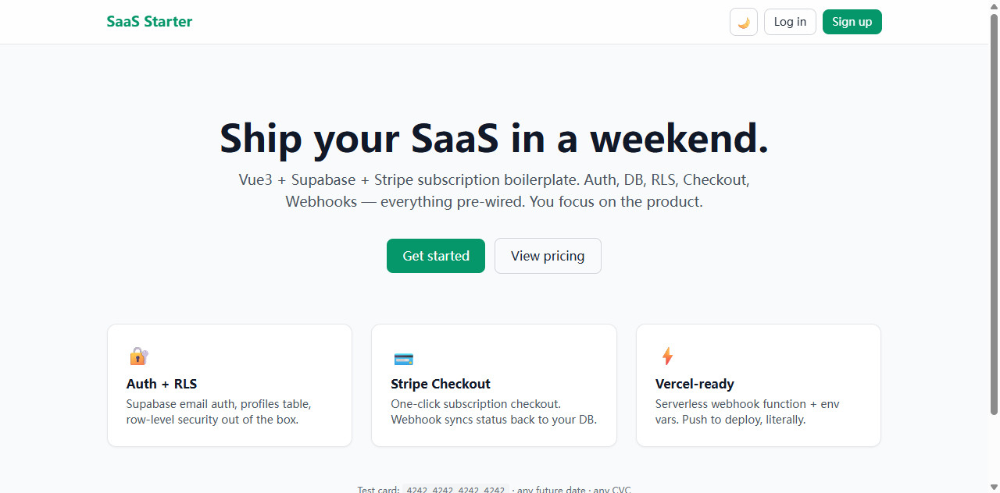
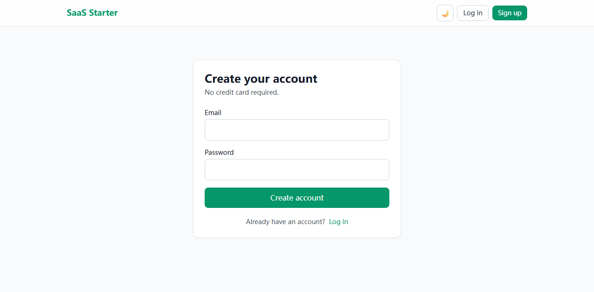
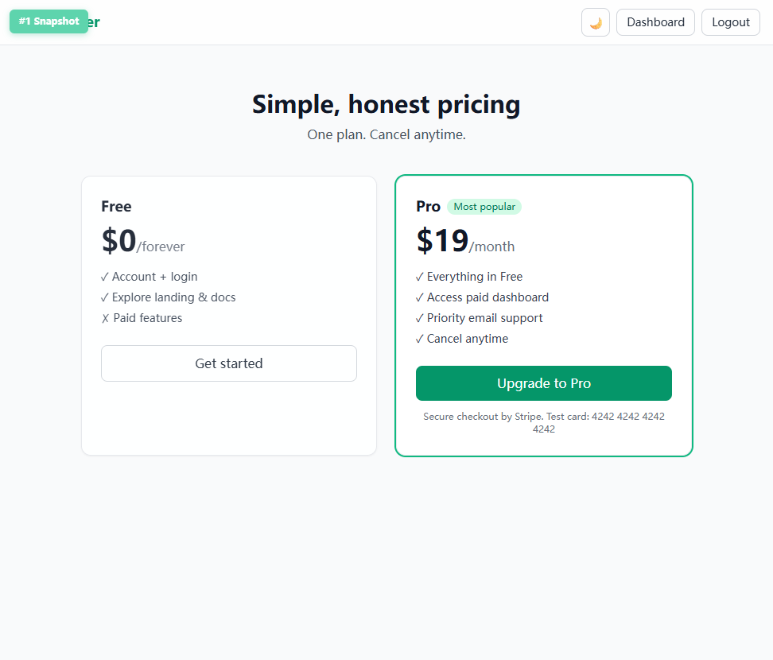
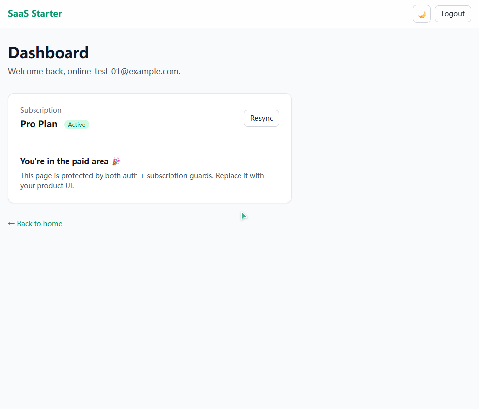

# Vue 3 + Supabase + Stripe SaaS Starter

**A production-ready SaaS boilerplate for indie developers.** Auth, Postgres + Row Level Security,
Stripe Checkout and subscription webhooks — already wired, tested end-to-end, deployed on Vercel.

> Live demo: **https://saasplate.dev**
> Test card `4242 4242 4242 4242` · any future date · any CVC · ZIP `12345`



---

## Why this exists

Every small paid tool I shipped needed the same four things before I could touch the actual product:

1. Email auth with a working confirmation link
2. A `profiles` table with RLS that a new Supabase project actually accepts
3. Stripe Checkout
4. A webhook that flips `subscription_status` from `free` to `active`

That's 2–3 days each time — and the webhook was always the part that broke first:

- signature verification fails when the body has been re-serialized by the framework
- `403 permission denied for table profiles` because newer Supabase projects need explicit `GRANT`s
- `/api/*` simply doesn't exist under plain `vite dev`, so Checkout can't be tested locally

This starter is the version of that work I wish I'd had. It is **infrastructure only** —
no blog, no chat, no analytics dashboard. You plug in your product.

---

## Demo walkthrough

| Register | Pricing | Paid area |
|---|---|---|
|  |  |  |

1. Sign up with any email → confirmation link lands on `/callback` → session established
2. Unauthenticated `/dashboard` → redirected to `/login?redirect=/dashboard`
3. Authenticated but unpaid `/dashboard` → redirected to `/pricing`
4. Pay with the Stripe test card → `/dashboard?paid=1` → **Pro Plan Active**

---

## What's included

| Area | What you get |
|---|---|
| **Frontend** | Vue 3.5 `<script setup>` · TypeScript · Vite 6 · UnoCSS |
| **Auth** | Supabase email signup / confirmation callback / login / logout |
| **Database** | `profiles` table · `handle_new_user` trigger · owner-only RLS policies · explicit `GRANT`s |
| **Payments** | Stripe Checkout (subscription mode) · customer ID stored on the profile |
| **Webhook** | `checkout.session.completed` · `customer.subscription.updated` · `customer.subscription.deleted` |
| **State** | `free` / `active` / `canceled` / `past_due`, synced with the service-role key |
| **Guards** | Auth guard + subscription guard, with `?redirect=` round-trip |
| **UI** | Landing · Register · Login · Pricing · Dashboard · dark/light toggle · responsive |
| **Deploy** | `vercel.json` with SPA fallback + two serverless functions in `/api` |
| **DX** | `.env.example` · local API shim (`npm run dev:api`) · troubleshooting doc |

**Not included (on purpose):** business features, admin panel, email templates beyond Supabase defaults,
multi-seat teams, usage-based billing. Keep it light and replaceable.

---

## Tech stack

Vue 3 · TypeScript · Vite · Pinia · Vue Router · UnoCSS · Supabase (Auth + Postgres + RLS) · Stripe (Checkout + Webhooks) · Vercel Serverless Functions

---

## How the flow works

```
/register ──► Supabase signUp ──► confirmation email
                                      │
                                      ▼
                              /callback (session)
                                      │
                          ┌───────────┴───────────┐
                          ▼                       ▼
                   subscription = free      subscription = active
                          │                       │
                          ▼                       ▲
                      /pricing ──► Stripe Checkout │
                                      │           │
                                      ▼           │
                          Stripe webhook ─────────┘
                          (service_role → profiles.subscription_status)
```

Route guards read `profiles.subscription_status`; the only writer is the webhook (service-role key).
RLS keeps the browser key read/write-scoped to the owner's own row.

---

## Quick start (about 5 minutes)

```bash
git clone <this repo>        # then copy the purchased source over it
npm install
cp .env.example .env         # fill in your keys
npm run dev                  # frontend  → http://localhost:5174
npm run dev:api              # local handler for /api/* → http://localhost:5175
```

Then run `supabase/schema.sql` in the Supabase SQL editor, create a recurring Stripe price,
and forward webhooks with the Stripe CLI:

```bash
stripe listen --api-key sk_test_xxx --forward-to http://localhost:5175/api/webhook
```

Full setup, with screenshots and the pitfalls I hit, is in the documentation that ships with the source.

---

## Deploy

```bash
vercel link
vercel env add VITE_SUPABASE_URL production
# … the other six variables
vercel --prod
```

Add your production domain to Supabase → Authentication → URL Configuration (Site URL + Redirect URLs),
then create a Stripe webhook endpoint pointing at `https://<your-domain>/api/webhook`.

---

## FAQ

**Do I need a paid Supabase plan?** No. The free tier is enough to launch.

**Does it work with Nuxt or plain Vite + React?** This repo is Vue 3. The Supabase/Stripe side is
framework-agnostic, but the UI and guards are Vue-specific.

**Why is `/api` a separate dev server?** Vercel functions don't run under `vite dev`. The bundled
`npm run dev:api` executes the same handlers locally and forwards them through a Vite proxy.

**Is this subscription billing with usage limits?** No — single recurring price, `subscription_status`
on the profile. Metered billing is your product decision.

**License?** Single-buyer license, unlimited personal and client projects. Reselling the source itself
is not allowed.

---

## Where to get the source

The full source, setup guide and troubleshooting notes are sold as a one-time purchase ($29)
→ **[Gumroad link]** · 14-day refund, no questions asked.

Issues and questions about this preview are welcome in the repo's Discussions tab.
